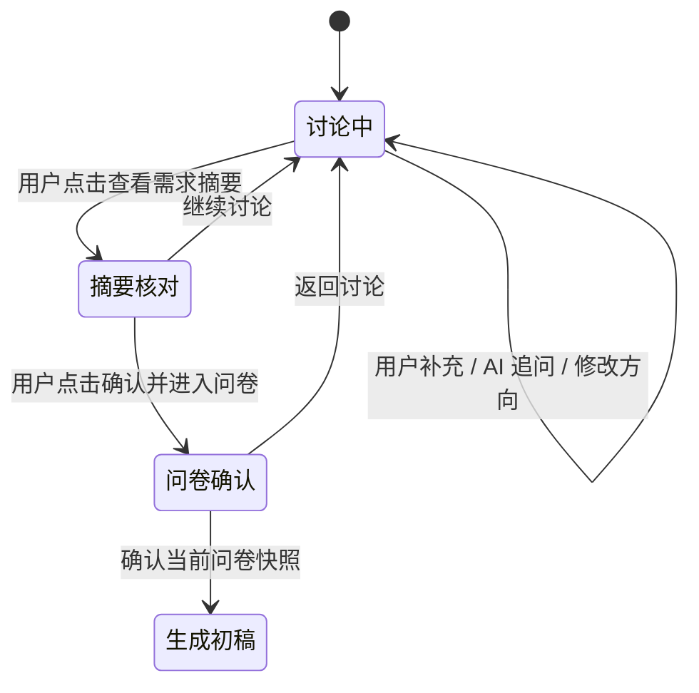

# FINNS-REQ-014：多轮需求沟通方案

日期：2026-10-10。状态：已按用户要求纳入下一版本计划（暂定 0.7.0）；聊天恢复边界、具体产品原型及实施范围待确认，未实施。版本安排见 [0.7.0 计划](iterations/0.7.0/PLAN.md)。

## 1. 用户原意与当前差异

用户希望在创建专题前与 AI 充分讨论想法：遇到不明确之处继续追问，双方确认方向后才进入问卷。用户观察到当前沟通 token 消耗较低，希望明确改进方式。

当前 0.6.0 实现每次发送最近 20 条消息和当前问卷，后台一次调用 DeepSeek，要求简短回复与字段提取；成功后前端无条件打开问卷。模型使用非思考模式，沟通输出上限 2,048 tokens。核心差异是对话任务、需求状态与结束条件，没有证据表明仅提高 token 上限能解决。

沿用 FINNS-REQ-014，以 FINNS-REQ-014/CONVERSATION 标识新增阶段，不覆盖需规 0.5 原文，不重置已上线的首轮/第二轮状态。用户已确认将多轮沟通纳入下一版本；下文具体交互及技术边界仍需评审和原型确认后实施。当前应用与源码版本仍为 0.6.0。

## 2. 推荐交互



- 第一条消息后保持在聊天页，展示回复，不自动弹问卷。
- AI 先复述理解，再处理本轮最影响方向的 1–2 个问题。已明确的内容不重复询问；如果用户要求比较方案或解释理由，先回应，再提出必要问题。
- 不设置最低对话轮数。信息充分时一轮即可形成摘要；信息不足时继续交流。用户明确说暂不确定，可以记录为待定。
- 桌面在聊天旁展示可折叠的“当前需求摘要”，手机以折叠卡片展示。字段包括主题、读者、用途、目标、内容范围、风格/交互、原始资料状态及待定事项。
- 将“用户明确表达”“AI 建议”“尚未确定”标明，不能把 AI 推断直接写成用户事实。
- “查看需求摘要”是查看/核对操作；“确认并进入问卷”是明确的用户操作。模型认为 ready 只显示建议，不打开问卷、不生成内容、不保存作品。
- 保留“直接填写问卷”入口。无需聊天、没有个人 Key 或 AI 请求失败时，作者仍能手动推进。
- 进入问卷仍使用原有必填规则（主题、人群、用途），风格提供默认；目标等可选项不因本方案自动变为必填。
- 确认后返回讨论并修改要求，原确认快照失效，显示变更；原已生成/已保存文档保持到作者接受新的候选结果为止。

## 3. AI 每轮的任务与指令

首轮继续使用当前 DeepSeek 直接调用，不引入 Agent 框架、自动循环、联网检索或工具调用。

建议的核心系统指令：

> 你是协助创作者梳理专题方向的产品伙伴。先理解用户想帮助谁、解决什么或提供什么体验，再讨论范围、资料和展示方式。每轮先回应用户本轮的问题或修正，再追问最影响方向的最多两个问题。已经明确的内容不重复问；用户没有确定的事项保留待定。用户要求建议时，给出具体备选及取舍并标为建议。不要强迫固定轮数，不催促填表，不编造资料。准备充分时提出可以核对摘要，由用户决定是否进入问卷。只返回规定 JSON；其中可见回复为自然中文，结构化字段供平台校验。

提问顺序应随信息调整，避免机械逐项问卷化：

1. 目标人群与期待成果：读者看完希望做成什么？
2. 内容边界：覆盖哪些关键问题，本轮先排除什么？
3. 资料状态：作者已有经验/笔记/链接，哪些尚待补充？
4. 展示方式：更适合按步骤、问题速查、路线还是参考文档？可解释建议原因。

是否“聊充分”用可核对结果判断：已有明确的基本方向、重要分歧已提出、剩余事项有明确待定标记；AI 的 ready 建议不能替代作者确认。对话深度来自回应、纠错与取舍讨论，回复长度不是质量指标。

## 4. 请求与返回契约建议

继续使用 `POST /api/me/topic-builder/chat`，新增显式 `contractVersion: 2`。既有 v1 在过渡期保留原契约，避免旧标签页解读新响应。新前端只在完整校验通过时更新状态。

建议请求字段：

| 字段 | 用途 |
| --- | --- |
| contractVersion | 固定 2，未知版本明确报错 |
| requestId | 本轮请求 ID，关联响应与取消/迟到保护 |
| briefRevision | 当前工作摘要版本，防止旧回复覆盖后续修改 |
| messages | 最近最多 20 条双方原文，每条有稳定 ID；沿用单条 3,000 字限制 |
| workingBrief | 累积方向、用户事实、AI 建议、待定事项；是本次输入数据，不是系统指令 |
| form | 当前问卷及作者手动答案 |

建议模型输出（示意，不是现有接口）：

```json
{
  "reply": "我理解你想帮助第一次短租的人建立判断顺序。你更想覆盖找房到退租全过程，还是先集中解决找房和看房？",
  "suggestedPhase": "discuss",
  "questions": [
    { "id": "q-scope", "text": "本轮内容准备覆盖到哪个阶段？" }
  ],
  "changes": [
    { "field": "audience", "operation": "set", "value": "第一次短租的大学生", "basis": "user", "messageId": "u-1" }
  ],
  "openIssues": ["内容范围尚未确认"],
  "readyReason": ""
}
```

服务端验证和合并后，再向浏览器返回规范化的工作摘要、差异、待定事项，以及平台计算的缺项和是否可建议核对；附当前已有的 model / usage / elapsedMs。

- `suggestedPhase` 仅允许 discuss/review，不包含自动打开问卷等执行权限。
- `changes` 字段使用白名单，set/clear 显式操作；未知字段/枚举、超限、空结果或截断拒绝。不得依靠合法 JSON 推断业务合法。
- 用户明确纠正“改成毕业生”“先不包含退租”时，可以修改或清除旧的工作摘要，不能继续采用现有“非空字段永不更新”的合并方式。
- 标为 user 的变化必须关联本轮或传入原文中的真实用户消息；模型自称来源不算已确认。建议显示差异，最终由作者核对摘要。
- AI 推断与建议保持待确认；手动编辑过的问卷答案不被后台建议静默覆盖，冲突展示给作者选择。
- 每轮更新工作摘要，不改 `confirmedForm`。只有用户明确确认当前 revision 后，才复制成问卷的确认基础；后续生成仍使用确认时快照。
- 每次发送一次模型请求，沿用每用户一个 AI 请求、Session/CSRF/本人 Key 和显式错误；不自动重试收费请求。
- 发送前捕获工作摘要版本；取消、离开、重新发起或手动修改后，旧响应不得覆盖新状态。取消界面等待不承诺取消上游已经发生的计费。

## 5. 上下文与资料处理

DeepSeek Chat Completions 是无状态接口，多轮需要由应用在每次调用时组织上下文。官方说明：[多轮对话](https://api-docs.deepseek.com/guides/multi_round_chat/)。本项目建议采用以下组合，而不是只保留最后一段聊天：

1. 固定系统规则。
2. 当前结构化工作摘要，显式区分用户内容、建议与未定事项。
3. 最近最多 20 条消息原文，以及本次用户输入（不得重复附加本次消息）。
4. 作者当前手动问卷值及原始资料；所有内容都作为数据，不能覆盖系统规则。

首版建议每轮增量维护摘要，不新增“专门总结”的额外模型调用；较早消息不再完整传入时，其关键方向保留在工作摘要。摘要本身也可能遗漏或误解，因此必须可见、可修改，并对内容超限明确提示，不能无提示截断。服务端按字段/字符容量限制上下文，字符限制不能冒称精确 token 限制。

聊天中的经历与引用不自动全部塞进 source。提供“将这段加入原始资料”操作，仅将用户选择的原文追加并校验现有 16,000 字上限；AI 建议保持单独标识。保持现有规则：无原始资料时只生成待补充结构，并在确认摘要中明确说明。这样作者的创作要求和被整理的事实资料不会混为一体。

## 6. token 与模型

- 首版沿用现有默认模型、非思考模式和沟通输出上限 2,048 tokens，先做多轮质量验收；只有可复现截断或容量不足，才调整上限和校验规则。
- API 返回的 prompt_tokens / completion_tokens / total_tokens 在聊天详情中展示每轮和当前会话累计。统计包括结构化输出，不只是可见回复；缺失用量显示未知，不记为 0，也不声称等同于账户账单。
- 累计只统计获得有效 usage 的调用，失败或已取消且未收到 usage 的请求单独标明“用量未知”。不能用当前会话统计代替账号历史消耗。
- 不设最低 token 数，不为了“看起来深入”拉长答案。验收看是否记住需求、问对问题、回应修正，以及是否能形成一致摘要。
- 深度思考、模型切换、流式呈现可后续单独评估；不是首轮多轮澄清的前置依赖。

## 7. 两步实施顺序建议

### A. 先验证真正的多轮澄清（推荐首轮）

实现对话指令、结构化工作摘要、显式核对入口、修正与差异、请求版本保护、每轮用量显示，以及选择聊天原文加入资料。接入既有问卷和候选生成/保存流程。

首版讨论状态只在当前页面内存中保留，离开/刷新继续使用未保存保护；明确提示尚未保存。原私人草稿仍按按钮保存，保存确认问卷与资料快照。首版不承诺刷新、重新登录或跨设备恢复完整聊天；没有新的持久化或数据库迁移。这是建议的迭代边界，不是已获得用户确认的豁免。

### B. 再实现讨论会话恢复（如用户要求）

增加按账号归属的讨论会话与消息持久化，保存工作摘要、修订、原文、用量和阶段；服务端重建上下文。只有实施确认后才设计追加 Flyway（若届时仍到 V10，则拟 V11），提供恢复路由、分页、版本冲突、保留期限与清理规则。需要单独确认聊天记录是否保存及保存期限，不能默认永久保存。

纳入下一版本不代表获得 A/B 的业务实施授权；本轮不执行 A/B，不连接数据库或启停 8080/8082。先按新交付流程明确需求及产品原型，再展开概设、详设和获授权的实现；后续实施先在隔离环境验收，部署主站需有对应明确授权。

## 8. 可观察验收标准

1. 输入模糊想法后，AI 给出理解与针对性追问，页面保持聊天，不弹问卷。
2. 已说明人群与目的时不重复询问；用户问方案差异时先回答问题，不只继续索要字段。
3. 一次给出完整要求时允许直接建议核对，不强制多聊若干轮。
4. 连续交流后能保留较早的核心范围；有冲突时明确指出，不把 AI 猜测当成用户确认。
5. 用户纠正人群、撤销一个范围或说暂不确定，工作摘要及待定项正确更新。
6. 只有点击“确认并进入问卷”才进入；AI suggestedPhase=review、消息中单独写 ready 或伪造字段均不能自动跳转。
7. 确认后再修改方向，会提示重新核对；生成使用最新确认快照，旧响应不覆盖，旧已保存草稿不被自动修改。
8. 选择用户原文加入资料保留原文，模型建议不会悄悄进入资料；无资料仍清晰提示仅生成结构。
9. 未配置 Key、超时、无效 JSON、截断、取消、版本冲突和用量缺失时输入保留，状态不会误进入已确认。
10. 桌面、390px、768px 下对话、摘要、核对和返回均可操作，阅读/保存等现有流程回归通过。

自动化使用固定模型响应验证状态与异常，真人用租房、看番、工具学习三类任务检查问题质量。未来真实验证预算须另行明确，建议三个案例各 2–3 次沟通（6–9 次请求），不自动重试；本轮未调用模型。

## 9. 本轮记录与待决

原方案轮已完成：当前代码差异核对、方案与接口建议、实施顺序、验收标准、官方多轮文档核对；当轮未写 Plane。随后用户要求纳入下一版本并更新 Plane、创建交付流程 skill，当前安排及实际同步结果分别见 [版本计划](iterations/0.7.0/PLAN.md) 与 [同步回执](iterations/0.7.0/PLANE_SYNC.md)。多轮功能仍未实现，版本仍 0.6.0；未修改原型、数据库、运行服务或调用收费模型，未提交/推送 Git。

需要在实施前确定：是否接受 A 的页面内存边界，还是首轮就要求 B 的服务端聊天恢复；其余交互按本方案推荐方案评审。不是要求现在反复确认 token 数或框架选择。
