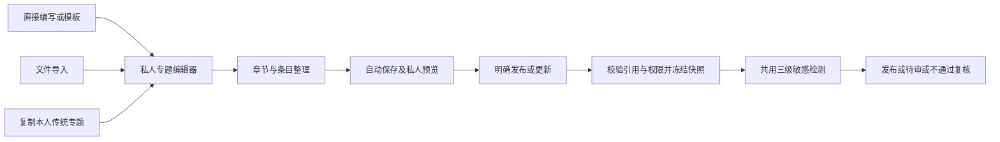

# FINNS 0.7.0｜F03 传统专题接入审核

## 当前评审：修订2，2026-10-21

状态：**用户整项确认，G1 pass**。本节取代下方修订1的过时审核依赖与现状描述；未被本节取代的专题行为随PUBLISH-D01整项确认，旧审核政策不再适用。当前源码及目标版本均为0.7.0，核对基线`release/0.7.0`的`c0119db`；本轮已确认归档并只读重读FINNS-18/19，标题/正文差异待逐项确认；未制作原型、开发业务或写Plane。

### 1. 与文章共同的底座、独立的创作过程

依照[F08已确认修订6及§10.8](FOUNDATION_REVIEW_REQUIREMENTS.md)和本轮源码，专题首次与后续更新均使用同一三级管线：无命中直接发布，低敏感放行留痕，中敏感送另一位有权者审核，高敏感自动不通过并人工复核；多条取最高。取消“首次必审”“前2次拦截、第3次人工”和“复制后首次必审”。检测不可用仍阻止新发布。禁止自审、固定提交快照、旧公开版保护、下架独立恢复等规则保持。

本轮product-discovery问答及解释记录集中于[文章修订2§1](FOUNDATION_CONTENT_REQUIREMENTS.md)。用户让AI选择常规发布体验，本轮采用本次请求内完成检测、之后可在“我的内容”查看人工后续；不新建后台队列。文章手动保存的既有决定不扩展成“所有专题也必须手动保存”。

### 2. 推荐的专题创建与发布流程

1. **选择创建方式**：传统专题复用现有直接编写/模板、文件导入，以及从本人传统专题复制的入口。各入口创建新的私人专题，随后汇入同一编辑器；追加导入进入已有私人工作稿。不另造创建系统或改写导入器。
2. **整理结构与内容**：设置名称、简介，组织章节与条目，补正文或引用已发布文章，设置有权使用的公开/受限范围。沿用容量边界；允许先保存不完整工作稿。
3. **保存与私人预览**：沿用现有自动保存（约1.2秒）及手动保存入口。私人保存不检测、不发布；预览/发布前先确认保存成功，失败保留输入。工作稿的可见范围修改不立即改变旧公开版。
4. **明确发布/更新发布**：校验章节、有效条目、引用和权限，保存后冻结本次内容与可见范围，再进入与文章相同的三级检测；不要求专题首次一律经过人工。
5. **返回结果并查看流转**：发布成功给出阅读入口；送审/高敏感复核给出真实状态，保留工作稿。复用“我的内容→我创建的专题”的对应条目和流转，避免再造独立的“我的发布”中心；旧有效版在等待/失败/驳回时保留。
6. **持续维护**：继续修改和保存仅影响私人稿；明确更新发布才形成新提交。取消本次送审保留旧公开版；撤回已发布专题则停止公开、私人保留，旧任务失效。两者是不同动作，具体确认提示在原型验证。
7. **复制/重发**：副本是新的私人专题，不继承原任务/发布结果；首次公开仍走正常三级检测，**不另加首次人工审批**。作者撤回重发同样检测；人工下架不能被这些动作解除。

**AI创建专题的边界**：项目已有AI BUILDER，但其工作稿仍私人；本轮不将“讨论专题创建流程”解释为允许其直接公开、转换成传统专题或接入对外发布。其创建→编辑→私人保存/预览继续存在，公开发布若要纳入须再明确范围。自选专题是整理他人内容的能力，不等同创作并发布一个传统专题。

### 3. 最新实现与剩余适配

| 位置 | 本轮核对事实 | 后续工作 |
| --- | --- | --- |
| [CollectionWorkspaceController.publish](../../src/main/java/com/aitome/content/CollectionWorkspaceController.java)、[ReviewService.submitCollection](../../src/main/java/com/aitome/review/ReviewService.java) | 传统专题已按三级管线处理；首次不必审，发布快照/审核快照已有支撑。 | 复用；不把整个FINNS-19描述成“尚未接入审核”，完整创建/取消/撤回/复制/引用行为仍须分项确认与验收。 |
| [CollectionEditorPage](../../frontend/src/pages/CollectionEditorPage.vue) | 已有自动保存、手动保存、预览前保存及送审/自动不通过提示，旧COL-F02的“送审会误报已更新”描述已不符合当前分支。 | 补齐具体创作流转与结果/草稿/公开版关系，校验失败及离开保护沿用。 |
| [MyContentPage](../../frontend/src/pages/MyContentPage.vue)、[FlowTimeline](../../frontend/src/components/FlowTimeline.vue) | 合并“我的内容”与专题逐条审核流转已存在；创建/草稿及更新/撤回为预留。 | 新增的真实生命周期事件接入原展示，不重复做审核页。 |
| [CollectionPublicationService.read](../../src/main/java/com/aitome/content/CollectionPublicationService.java) | 引用已过滤VISIBLE；不可用占位仍带条目title/annotation。 | 补未来文章作者撤回过滤，并明确这些字段若含原文信息须隐藏；不再声称只查文章是否存在。 |

### 4. 对修订1条款和验收的定点修正

| 原条款/验收 | 当前修订2定义 |
| --- | --- |
| COL-R02/R03、COL-A02/A03 | 首次公开/受限与更新均四路分流，不按命中次数；受限阅读权限独立检查。 |
| COL-R05、COL-A05 | 更新不依赖首次审批资格；无/低命中可更新，中/高处理期间保留旧有效公开版。 |
| COL-P02、COL-A08 | 保留本人工作稿复制、新ID、私人草稿和不继承任务；“首次重新审批”替换为“按同一三级规则重新检测”。 |
| COL-R06、COL-A06/A07 | 取消送审与撤回公开版分开；作者重发重新检测，人工下架独立恢复。 |
| COL-P03、COL-A09/A10 | 随修订2整项确认：草稿可含失效引用，发布时阻断定位；发布后引用失效仅该条占位，提交处理前引用又失效则需修正重提。 |
| COL-A13 | 保留重试幂等及并发防错；删除次数与首次审批资格有关的断言。 |
| COL-A15/A16 | 以现有合并“我的内容”、真实流转和编辑器为起点补作者流程；不把占位及历史F08验收当作专题创作链路验收。 |

其余COL-R01–R10及COL-A01–16未被取代的定义随PUBLISH-D01整项确认，审核政策全部以本节/F08修订6为准；[当前验收清单](../iterations/0.7.0/ACCEPTANCE_COLLECTION.md)16项全部未执行，历史测试不替代本项验收。

### 5. 阶段、取舍与下一步

2026-10-21用户明确“确认需规，完毕以后，进行下一步”，[PUBLISH-D01/D02](PUBLISHING_DECISIONS.md)绑定本修订2及文章修订2，G1通过。遗留项COL-L01–03登记后交G2/G3/G4；取消送审/撤回、失效引用及保存区别在原型中展示。需求批准不是具体原型通过或业务实施授权；下一步[COLLECTION-SYNC-P01](FOUNDATION_COLLECTION_PLANE_P01.md)逐项确认并回读，检查点满足后按用户指令继续[具体原型](../iterations/0.7.0/PROTOTYPE_PUBLISHING_BRIEF.md)，当前仅任务书。

与F02共享审核契约及有效文章读取约定；依赖不等于等F02整个任务部署后才能继续设计。F08已验收、尚未部署的事实单独保留。FINNS-18/19的管理差异已准备并待逐项确认；本轮仅按既有工作项范围重读，不自动写入。

本轮只做源码/需求/历史验收及进度静态核对和文档更新，未执行业务测试、构建、浏览器/手机、数据库或运行态检查；未改业务、原型、服务、版本或Git。下方2026-10-18的Plane内容、旧源码观察和阶段均为历史；本轮只读重读的管理差异以P01为准。

---

确认记录：PUBLISH-D01，2026-10-21；用户“确认需规，完毕以后，进行下一步”。确认对象为本文件修订2及其替换关系，不批准已被取消的旧首次审批/次数规则，也不代表业务验收通过。

## 历史草案：2026-10-18修订1（审核依赖由上方修订2取代）

日期：2026-10-18（Asia/Singapore）。需求修订：1，**评审草案，待用户确认，G1 pending**。内部需求：FINNS-REQ-020/COLLECTION；Plane：FINNS-19（`923e172c-6b67-4def-bfe5-745e68441ded`），父项 FINNS-14；本地任务：`foundation-collection`。

本轮来源：用户“评审FINNs-19需求”。授权范围为只读需求/源码核对与本地评审记录；未授权业务实施、原型制作、数据库迁移、发布、Git 操作或 Plane 写入。当前源码四处版本均为0.7.0；本项目标版本也是0.7.0，不表示本项已发布。

## 1. 评审结论

方向合理，可以复用既有传统专题编辑器、工作稿/发布快照、导入和复制；本项承担专题适配，不另建审批政策或审批后台。**当前尚不能将G1记为通过**：需确认本修订补齐的作者操作、复制和引用处置边界；G2具体专题原型尚未制作。

### 已确定、直接复用的规则

依据[FINNS-17需规修订3](FOUNDATION_REVIEW_REQUIREMENTS.md)及REVIEW-D10，以下不是重新提问或新增建议：

- 私人草稿自由创建、导入、保存、编辑和预览；首次对外发布（公开或受限）须由另一名有独立审批权限者批准。
- 首次批准之后，更新及作者撤回后重新发布只做敏感检测；前2次命中拦截，第3次及本轮后续命中进入人工复审。首次审批与敏感复审同时触发时合并为一个任务。
- 计数按同一作者同一内容；网络重试不重复计数，刷新/重登/驳回不清零，检测通过或人工批准结束本轮。
- 站长也禁止自审；没有第二名审批者时等待。正常且有独立审批权限者可处理提交快照，该权限不授予查看他人全部私人工作稿的权利。
- 作者后续编辑不改变已送审快照；旧有效发布版在更新拦截、失败、待审或驳回时保留。撤回、重提、停用、下架与审批并发不得使过期动作重新公开内容。
- 旧已发布专题保留原可见范围和历史来源，不补造首次审批记录；人工下架是独立限制，恢复须另一名审批者复核并填写原因。账号恢复不恢复被下架作品。
- 受限阅读与发布审批分别生效；AI BUILDER工作稿仍私人，不能借传统专题接口发布或转换。

### 本次发现及处理建议

| 编号 | 问题与证据 | 评审处置 |
| --- | --- | --- |
| COL-F01 / 重要 | Plane FINNS-19仍写“发布/更新发布接入F08统一审核”，没有明确首次审批/更新检测区别；FINNS-17远程已同步修订3。 | 本地沿用F08已确认规则；本项G1通过后提出FINNS-19正文精确差异，单项授权后写入回读。当前未更新远程。 |
| COL-F02 / 原型前补齐 | [编辑页](../../frontend/src/pages/CollectionEditorPage.vue)的`transition`按旧直接发布流程处理，只同步旧状态并提示“已更新公开版本”。新送审状态若复用该反馈，会误报已公开。 | 明确首次提交、拦截、送审、驳回、取消送审、更新发布等动作与结果；工作稿/审批/读者版分别显示，不能只用一个状态标签表达。 |
| COL-F03 / 实施前阻断 | [发布读取](../../src/main/java/com/aitome/content/CollectionPublicationService.java)目前按文章记录是否存在判断引用可用；缺失占位仍保留条目`title`/`annotation`。仅记录存在不足以适配未来撤回、下架、阅读权限；历史快照也可能含旧原文信息。 | 引用读取必须按当前访问者的文章有效发布版及阅读权判断；不可用时不回传原文标题、摘要、作者、正文或其他携带原文信息的引用字段。公开响应与页面同时验证。 |
| COL-F04 / 需求补齐 | [复制实现](../../src/main/java/com/aitome/content/CollectionImportController.java)目前复制本人当前工作稿，生成新的DRAFT；审核资格如何处理尚未在FINNS-19写明。 | 推荐COL-P02：保留本人工作稿复制语义，新ID不继承原审批资格/待审任务/处理记录，首次对外发布重新审批。 |
| COL-F05 / 兼容事实 | [编辑页](../../frontend/src/pages/CollectionEditorPage.vue)已有自动保存（约1.2秒）、手动保存、预览前保存及离开保护；工作区有50章/500条等校验。[旧测试](../../src/test/java/com/aitome/CollectionImportTests.java)已有快照隔离、复制、失效引用与归档场景。 | 复用现有保存和容量边界；不把传统专题重新设计为只手动保存，不重做导入解析器。本轮仅静态阅读，未复跑旧测试。 |

COL-F03是接入F02新内容状态后的适配要求；本轮没有运行复现，不据静态核对宣称当前线上已发生数据泄露。F08 R2具体原型及规则CRUD增量仍待用户评审，本项不将其视为已批准范围，也不因此撤销F08既有修订3。

## 2. 本修订建议冻结的专题行为

以下COL-R01–R10为分项完整草案；第1节已确认规则直接复用，其他细化须随本修订确认。

| ID | 场景 | 可观察行为 |
| --- | --- | --- |
| COL-R01 | 创建/导入/编辑 | 保留传统OUTLINE编辑器和现有模板；支持已有笔记、外链、本人站内内容引用、章节/排序。自动保存及手动保存只更新工作稿；未完整内容可保存，提交时按既有规则定位缺项。导入不自动送审或发布。 |
| COL-R02 | 首次发布 | 主动提交当前已保存版本；服务端校验结构、权限、引用和可见文字。检测通过进入首次审批；第1/2次命中提示修改，第3次合并首次/敏感原因送审。返回“待审批”等真实结果，不能提示已公开；公众看不到该提交。 |
| COL-R03 | 检测覆盖 | 覆盖专题名称、简介、目标读者/目标、章节标题/说明、条目标题/说明/笔记正文/外链显示文字等对外可见文字。引用文章沿用其有效发布版及阅读权限，不把文章私人修改稿带入专题；不访问外链抓取网页或新增外部检测服务。 |
| COL-R04 | 待审/驳回 | 作者可看本人提交版本、触发原因、处理状态及驳回原因；可继续编辑工作稿，但不改变送审快照。重提明确提示替代旧任务，旧任务失效；只有获批提交版本可发布，不能把作者之后的修改一并放行。审批结果返回时工作稿仍独立保留。 |
| COL-R05 | 已发布更新 | 保持原详情URL和专题ID。更新检测通过才替换读者快照；命中/检测失败/待复审/驳回期间仍展示旧有效版。页面明确“工作稿有修改”“更新待审，读者仍看到旧版”等组合状态；不将有旧版的待审专题从公众入口整体移除。 |
| COL-R06 | 撤回与下架 | 推荐COL-P01区分取消本次送审和撤回对外发布；人工下架独立标识，作者不能自行解除。作者撤回后保留私人工作稿；已获首次审批者重发不再首次审批，旧历史基线也不补造批准。送审失效、重发和恢复均沿用F08规则。 |
| COL-R07 | 复制 | 推荐COL-P02：仅复制本人传统专题当前工作稿；“复制内容”保留内容/结构，“只用结构”沿用现有空内容语义。副本是独立私人草稿、新ID；不继承审批资格、待审任务、发布快照、下架恢复资格或处理记录。公开/受限选择在副本提交前明确展示并独立校验，复制不授予权限。 |
| COL-R08 | 引用 | 继续只允许作者收录本人站内内容，不扩大为任意作者内容。推荐COL-P03明确提交时不可用引用的阻断与已发布版的占位；文章后续撤回、下架、删除或对当前读者无权时，专题不能暴露冻结原文信息，不能通过`outline`、兼容文章列表或自选入口绕过。 |
| COL-R09 | 受限与账号 | 沿用`collection.manage`/`content.restricted`现有角色边界，不新增会员/对象级ACL。可见范围绑定送审/发布快照，工作稿改范围不立即改变读者版。发布、最终批准及读取分别校验相应权限；审批权不转化为受限内容的对外开放权。作者停用使未处理提交失效，旧已发布作品仍按原范围可见。 |
| COL-R10 | 失败/并发 | 保存失败不送审，检测异常不新发布；保留当前输入和旧版。登录失效后原位重登录，换号不沿用前账号提交；版本冲突要求重读，保留本地输入。重复提交/审批不重复计数或发布，撤回/重提/停用/下架/撤权与审批的最终检查沿用F08契约。 |

工作稿修订、审批结果、当前读者快照及下架限制是不同事实；上表描述产品行为，不提前决定数据库枚举、DTO、迁移或锁实现。

## 3. 本轮待确认的三项细化建议

| ID | 推荐方案 | 备选及代价 | 影响 |
| --- | --- | --- | --- |
| COL-P01 | **区分“取消本次送审”和“撤回已发布专题”**：前者仅使当前待审任务失效，私人稿和旧有效版保留；后者立即停止对外可见，并使未处理任务失效，私人稿保留。首次待审无旧版时仅显示取消送审。沿用现有“归档”的公开撤回语义，具体文案在原型核对。 | 用一个“撤回”同时撤审、撤出版，动作更少，但作者想取消改稿审批时也会让旧版消失。 | 作者操作、确认提示、旧版读取及竞态验收。 |
| COL-P02 | **副本是新专题，首次发布重新审批**；继续复制本人当前工作稿，不复制审核/发布/处置资格。 | 继承原批准会把未经审批的新ID/改稿当作已获资格，不符合F08首次发布边界，不建议。 | 两种复制模式、新ID、首次审批与权限。 |
| COL-P03 | **提交时发现引用文章不可用，阻止本次提交并定位条目**，作者删除/替换后重试；已经发布的专题不因此整篇下架，阅读时对应条目只显示统一“原文已不可用/不可访问”占位，不返回受保护引用信息。提交后至审批通过前引用又失效时，提示本次提交失效需修正重提，不悄悄修改送审快照。 | 允许含失效引用的新提交继续发布，占位更宽松，但更容易形成不可读新专题；整篇下架则扩大文章状态的连带影响。 | F02有效文章查询、F03引用过滤、F04/F05读取联调及审批最终检查。 |

以上仍为建议，未代替用户决定。用户可逐项修改，或明确批准“修订1，含COL-P01–P03”；不要求重新选择F08已确认的规则。

## 4. 验收映射（全部未执行）

| ID | 需求/主场景 | 必须观察到的结果 |
| --- | --- | --- |
| COL-A01 | R01 创建/保存 | 模板、直接编写、导入新建/追加、未完整稿保存、私人预览及已有容量边界兼容；自动保存不公开、不送审。 |
| COL-A02 | R02 首次公开/受限 | 无命中也须另一名有权者审批；批准前列表、详情、数量、自选、搜索和公开主页不泄露；受限首次发布不能跳过审批。 |
| COL-A03 | R02/R03 敏感 | 可见字段覆盖、前2次拦截、第3次双触发单任务、计数重试幂等及结束/不清零规则符合F08。 |
| COL-A04 | R04 快照 | 送审后改工作稿不改变被审版；批准只发布提交版；作者可看原因，重提使旧任务失效。 |
| COL-A05 | R05 更新旧版 | 通过首次审批后的更新检测通过直接生效；拦截/异常/待复审/驳回期间，旧版内容与原可见范围仍有效。 |
| COL-A06 | R06/P01 两种撤回 | 取消送审保留旧有效版；撤回发布后全部公开入口失效且旧审批不能重新公开；私人稿保留。 |
| COL-A07 | R06 历史/重发/下架 | 历史已发布不补审记录；作者撤回重发只检测；人工下架不被保存/普通更新/账号恢复解除；恢复符合禁止自审和原因规则。 |
| COL-A08 | R07/P02 复制 | 两种模式只复制本人传统工作稿，新ID为私人草稿且首次发布重审，不继承任务/资格；不能跨账号复制或操作BUILDER稿。 |
| COL-A09 | R08/P03 提交引用 | 草稿可保留失效引用；提交定位阻断。送审后引用失效不得批准过期快照；移除/替换后可重提。 |
| COL-A10 | R08/P03 读取引用 | 删除/撤回/下架/无权引用均为统一占位，原文标题/摘要/作者/正文及携带原文信息的字段在响应中缺失；专题其余条目仍可读。覆盖旧快照、outline及兼容列表。 |
| COL-A11 | R09 可见范围 | 修改工作稿公开/受限不改变旧快照；最终生效范围来自提交版，无权用户在列表、总数、详情、检索、自选、公开主页/API均不能越权。 |
| COL-A12 | R09/R10 权限账号 | 非作者不能保存/提交/取消/撤回；作者停用或审批者失权/停用后旧操作拒绝；默认站长及禁止自审沿用F08，无人可审不放行。 |
| COL-A13 | R10 竞态 | 重复提交/审批、重提/撤回/下架/停用/撤权与审批并发，不重复计数、不发布错版、不把下架内容恢复；冲突明确要求重读。 |
| COL-A14 | R01/R10 输入保护 | 自动保存失败、版本冲突、断网、登录失效/换号保留输入；保存失败不提交，检测异常不发布新内容；刷新只承诺恢复已保存工作稿。 |
| COL-A15 | R04/R05 作者状态 | 我创建的专题和编辑器能区分工作稿、待审/驳回原因及旧有效版；新送审不再提示“已更新公开版本”，可分别查看私人/送审/读者版本。 |
| COL-A16 | 全部 页面联调 | 具体原型及后续实现分别检查桌面/390px/768px、直达刷新、前进后退、空/加载/失败/取消；真实服务端、隔离PostgreSQL持久化/并发和真人手机验收分别记录。 |

后续设计须将这些场景映射到F08统一审核契约和F02有效文章查询；F04/F05负责搜索/阅读及个人/公开入口的联调。不能仅靠审批后台或旧导入测试宣称本项完成。

## 5. 范围与阶段

纳入：传统专题发布适配、作者状态与必要操作、快照/引用/受限读取兼容、导入复制回归及对应验证。复用F08审核后台、规则与记录，不另建一套审核中心。

排除：AI BUILDER公开发布/转换、跨作者复制、图片/附件/新外链抓取、外部服务/AI语义检测、评价/租房、复杂权限模型、永久删除/任意历史回滚/多人协作、通知中心。传统专题继续现有自动保存，本项不替F02决定普通文章的保存或话题范围。

| 门禁 | 本轮结果 | 下一步 |
| --- | --- | --- |
| G0 | 通过，复用既有登记与0.7.0归版 | 本轮细化不改变已确认目标版本。 |
| G1 | 未满足 | 用户确认本修订范围、COL-P01–P03和验收定义，未确认部分保留待决。 |
| PLANE | 未满足 | FINNS-19已有登记，但正文落后于F08；G1通过后主动准备正文完整差异与保留字段，逐项确认后更新/回读或记录用户明确延期。 |
| G2 | 未满足 | F03具体原型待制作；F08 R2是依赖参考，不能当作本项原型或其用户批准。 |
| G3–G9 | 未满足 | 原型确认后再概设/设计评审、详设契约、获授权实施、验证、验收及发布。 |

用户下一步：确认/修改修订1，尤其三项细化建议。AI下一步：记录决定并协调本地入口；G1通过后主动处理Plane差异检查点，满足后再按授权制作专题原型。依据[阶段门禁](../../.agents/skills/finns-delivery-workflow/references/stage-gates.md)，“用户确认本轮需求”是G1进入下一步的条件；AI评审意见不能替代用户范围确认。

## 6. 只读核对与本轮验证

- Plane 2026-10-18：按标识符读取FINNS-19，标题“FINNS 0.7.0｜F03 传统专题接入审核”，Backlog，父项FINNS-14，负责人/标签为空、优先级none、日期为空；`updated_at=2026-10-17T15:06:13.496676Z`。评论0条且无后续页。依赖FINNS-17按限定字段读取，正文确认已同步修订3，`updated_at=2026-10-18T10:13:20.678216Z`。本轮未查询全项目、Cycle/Release成员，也未从单项`cycle_id`推断关联丢失。
- 源码核对：`CollectionWorkspaceController.publish/publishProblems/validateEntry`、`CollectionPublicationService.capture/read/publishSnapshot`、`CollectionImportController.commit/append/duplicate`、`CollectionEditorPage.vue`、`MyCollectionsPage.vue`、`Permission.java`及`CollectionImportTests.java`的相关段落。结论为静态证据，未运行复现或验收业务。
- 开始时工作区已有FINNS-17 R2等改动；全部保留。本轮仅新增本需规并增补交接、下一步、索引、Unreleased和本项进度，不更新其他任务状态/批准证据。四处发布版本保持0.7.0。
- 初次进度检查输出为各项真实待办，工具外层退出码报告1，未出现配置错误；收尾显式采集Python真实退出码重新核对，以交接中的最终记录为准，不据初次外层状态推定门禁通过。
- 文档检查方法：本地链接存在性、COL-R01–10/P01–03/A01–16完整性、状态JSON及全部pass/na证据哈希、其他任务对象和已有改动保留、四处版本/业务源码未改、文档差异格式；最终结果见交接及索引。不把文件检查当作业务验收。
- 未执行：原型制作、浏览器/手机、前后端构建、业务测试、数据库/邮件/模型、部署或Git提交推送；未调用任何Plane写操作。正式Plane全文差异待需求确认后准备，本轮只有管理差异结论，不能当作已批准写入载荷。

### 最终文档检查结果

2026-10-18：新增区域16处本地文件链接可达；10条需求、3项建议、16项验收及5项发现编号完整且各表内唯一；状态JSON可解析，全部83条pass/na证据路径与哈希有效。显式采集Python进度检查真实退出码为2，F03下一门禁仍为G1（真实待用户确认），不是配置错误或业务验收通过。`git diff --check`退出0；四处版本仍0.7.0，既有原型/其他代码改动的快照未被本轮修改。

边界校验首次发现`foundation-content`在本轮开始后发生同期需求记录增量，因此“除F03外所有任务与开始快照完全相同”的断言未通过。核对后保留FINNS-18的同期需规/进度/索引内容；其余任务对象与开始快照相同，原文档内容均保留，CHANGELOG只有增补。该增量不归为本轮F03完成事项，也不回退覆盖它。校正比较范围后的文档检查退出0。

脱敏边界快照及检查摘要位于`target/finns-19-review/`，属于已忽略、可清理的本机材料；不作为批准或业务完成证据。最终本地记录范围：本需规，加`docs/AI_HANDOFF.md`、`docs/NEXT_ITERATION_PLAN.md`、`docs/delivery-progress.json`、两个既有ARTIFACTS索引及`CHANGELOG.md`。未提交或上传这些材料。
