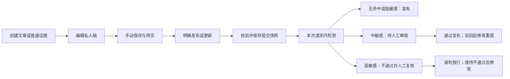

# FINNS 0.7.0｜F02 文章与普通话题草稿及发布

## 修订5增量：2026-10-22（PUBLISH-D13，用户确认）

状态：**用户确认**。本节只取代下列图片相关条款，其余修订2–4不变。来源：用户“允许文章显示 Markdown 图片（外链），更新需规”。

- **CT-R13 外链图片**：文章正文允许 Markdown 图片语法 `` 显示**外链图片**；仅 `http/https` 地址，`javascript:`、`data:` 等其他协议不显示；不提供图片上传或站内存储，不抓取或转存外部图片。编辑（阅读模式）、私人预览、读者阅读页使用同一渲染与同一过滤规则，所见一致。
- 取代：§7 安全 Markdown 条款中的“图片语法不外连/图片不加载（显示占位）”，以及验收 CT-A04 中“图片语法不外连”；非目标“媒体上传/远程图片”收窄为“媒体上传”。原始 HTML 仍不执行（含 `` 标签写法），脚本、事件属性与危险链接仍被清除。
- 新增验收 **CT-A17**（见[验收清单](../iterations/0.7.0/ACCEPTANCE_CONTENT.md)）。
- **CT-L06 已由用户选定（PUBLISH-D14，见[设计](../iterations/0.7.0/DESIGN_CONTENT_IMAGES.md)）**：不发送来源（no-referrer）、原生懒加载、等比缩放（≤版心宽、≤80%屏高）、失败占位“图片无法加载：说明（域名）”不自动重试；敏感检测覆盖图片说明与地址；编辑器与阅读页/预览统一用 Vditor（Lute）渲染。原题：外链图片的隐私与可用性处理——是否加 `referrerpolicy="no-referrer"`、懒加载、加载失败占位、尺寸上限；敏感检测是否覆盖图片说明文字与地址；外部图片内容本身不在检测范围（能力边界需告知）。编辑器 Vditor 与正式阅读页渲染器统一方案也在此处设计。
- 现状差距：已实施的 FINNS-18 代码（`frontend/src/lib/safeMarkdown.js`）按旧规则把图片显示为占位，**尚未改**；原型 Vditor 已能显示外链图片。实施需另行授权。

## 当前评审：修订2，2026-10-21

状态：**用户整项确认，G1 pass**。本节是当前评审入口；下方修订1保留为历史草案，不作为最新审核规则。当前源码/目标产品版本均为0.7.0。核对基线：`release/0.7.0`，HEAD `c0119db`。本轮已完成需求确认归档，并只读重读FINNS-18/19；Plane标题/正文精确差异待逐项确认，没有业务实现、部署或Plane写入。

### 1. 本轮来源、取舍与有效范围

用户要求按项目最新内容更新，并用已安装的 `product-discovery` 探讨文章与专题创建/发布流程。已读取该skill的artifact-first采访规则，沿用现有文档，按一次一个关键问题开展。

| 记录 | 来源与性质 | 结论 |
| --- | --- | --- |
| CONTENT-D01/D02 | 2026-10-18用户明确选择，SAID | 文章与普通话题同期；文章/话题手动保存、未保存离开提醒。保持，不重新提问。 |
| PF-Q01/A01 | 2026-10-21询问点击发布后的体验；用户答复“按照常规的即可，请你思考选取即可”，SAID | 用户授权AI选择常规方案；不是用户逐项指定了实现方式。 |
| CONTENT-D03 | 本轮AI依上述授权选择，INTERPRETED | 首期保持本次发布请求内完成敏感检测并返回结果；人工审核/复核可之后在“我的内容”查看，不要求作者留在编辑页。不新增后台队列或虚假的“排队检测”。 |
| PF-F01 | [F08需规§10修订6及§10.8](FOUNDATION_REVIEW_REQUIREMENTS.md)、ReviewService源码，已核对 | 三级敏感分流已取代次数升级和专题首次必审。相同规则接入文章/普通话题与传统专题；普通话题尚未在当前代码接入，列为本项缺口。 |
| PF-F02 | [F08用户验收结论](../iterations/0.7.0/ACCEPTANCE_CONTENT_REVIEW.md)及交接，历史证据 | F08修订6已获用户验收、已提交推送，未部署；不能把其完成写成F02草稿生命周期已完成。 |

**关键区分**：内容发布指作品对读者可见；本轮不涉及软件发版或主站部署。创作入口分“文章”和“专题”；普通话题保留为文章侧的内容类别、共用生命周期，不额外设计第三套流程。后者为本轮产品方案，不改变既有ARTICLE/TOPIC数据类型或声称入口已改造。

### 2. 推荐的文章流程（已确认具体方案，PUBLISH-D01）

1. **创建/编辑**：从创作入口或“我的内容”进入文章编辑页，填写标题、摘要、Markdown正文；普通话题同一规则。可先保存不完整私人稿，不触发检测或公开。
2. **手动保存/预览**：明确未保存、保存中、已保存和失败。预览读取当前输入，不因此发布。页面内离开有未保存输入时提醒，保存失败不离开；只承诺恢复已保存稿。
3. **点击发布/更新发布**：先做字段校验；通过后持久保存本次稿并冻结提交快照，再执行服务端敏感检测。校验失败定位问题；保存失败不送审，检测失败则保留私人稿和旧公开版。不能对未保存的旧稿误发。
4. **返回明确结果**：无命中/低敏感发布成功，提供“查看发布内容/返回我的内容”；中敏感显示“待审核”，高敏感显示“未通过，人工复核中”。后二者保留稿件、可返回继续编辑或查看本次流转，不清空表单后让作者无稿可改。具体结果区版式到原型确认，不为本方案强制新增独立结果页面。
5. **查看后续**：复用现有“我的内容”文章与话题页签，每篇展示工作稿、当前公开版及最近提交结果。待审/驳回/高敏感复核不影响旧有效公开版。作者不必等在页面；暂不新增邮件、推送或消息中心。
6. **修改重提/取消送审**：继续保存工作稿不改变送审快照；再次明确提交使旧任务失效。取消本次送审只撤销该提交，保留工作稿及旧公开版；不能与撤回已发布内容混为同一动作。
7. **撤回已发布内容**：二次确认后停止公开，保留私人稿，未处理提交失效；重新发布重新走同一检测。人工下架由独立恢复流程处理，作者保存/重提不得绕过。

### 3. 文章与专题共用的发布分流

本表直接复用F08修订6，不重新引入审批政策。一次命中多规则取最高等级。

| 检测结果 | 本次提交 | 后续与作者可见结果 |
| --- | --- | --- |
| 无命中 | 直接发布 | 已发布 |
| 低敏感 | 直接发布并留痕 | 已发布；管理侧可事后查看 |
| 中敏感 | 不公开新稿，交另一位有独立权限者审核 | 待审核；通过才发布，驳回给出原因 |
| 高敏感 | 自动不通过，同时建立人工复核任务 | 不显示具体命中词；复核可维持不通过或认定误判并放行，均须原因 |
| 检测异常/无启用规则 | 阻止本次发布 | 保留私人稿及旧有效发布版，允许修正/重试，不显示已发布 |

禁止自审、快照固定、失权/停用后的最终检查、旧任务失效、下架优先规则保持。**取消“前两次拦截、第三次人工”、计数阈值和“专题首次无条件审批”。** 更新发布与首次发布走相同分流；复制产生新内容仍重新检测，不继承原提交结果。

### 4. 最新源码边界与本项差距

| 已核对位置 | 当前事实 | 对本项的含义 |
| --- | --- | --- |
| [ContentController.create](../../src/main/java/com/aitome/content/ContentController.java)、[ReviewService](../../src/main/java/com/aitome/review/ReviewService.java) | ARTICLE已接入三级检测、固定快照、流转与幂等回执；TOPIC仍分支直接保存公开。已发布文章不支持以原目标继续改稿发布。 | 不重复开发审核中心；补普通话题接入、稳定稿件归属与完整改稿生命周期。 |
| [ComposerForm](../../frontend/src/components/ComposerForm.vue) | 尚无服务端文章草稿编辑；送审/自动不通过响应后也会清空表单并换draftKey。 | 这是F02创作体验需补齐的缺口，不能把F08验收当作文章存稿可恢复。 |
| [MyContentPage](../../frontend/src/pages/MyContentPage.vue)、[FlowTimeline](../../frontend/src/components/FlowTimeline.vue) | “我的内容”已合并文章/话题、我创建的专题、自选专题，已有本人审核流转；创建/草稿及更新发布/撤回阶段仍是占位。 | 复用这个入口，按真实事件补齐生命周期；时间线不是每次击键或自动保存都追加记录。 |
| [CollectionPublicationService](../../src/main/java/com/aitome/content/CollectionPublicationService.java) | 读取引用已检查moderation_state='VISIBLE'，不再只检查存在；占位仍保留条目title/annotation。 | 原修订1“只查存在”已过时；仍需核对这些字段是否携带被保护原文及未来作者撤回状态。 |

CT-R01–R08未被修订2取代的行为与非目标一并随PUBLISH-D01整项确认；审核依赖全部按本节替换。Markdown、文章服务端草稿、作者更新/撤回、完整读取过滤均已确认、待实施，不能写成已上线。修订1的2026-10-18 Plane核对只作历史；本轮最新只读核对与精确差异见[CONTENT-SYNC-P01](FOUNDATION_CONTENT_PLANE_P01.md)，未写入。

### 5. 验收修正与剩余发现

- CT-A05替换：文章与普通话题的无命中/低/中/高四路、取最高等级、异常阻止及请求重试幂等；不再验命中次数。
- CT-A06/07沿用旧版与快照保护，并覆盖高敏感复核、保存后改稿、重提失效及作者取回私人稿；当前接口的清空输入行为不能作为目标验收。
- CT-A08/09/11沿用撤回、下架/恢复、失权/停用和竞态；不再有专题首次审批资格及次数状态。
- CT-A13以既有合并“我的内容”为入口验收，创建/保存/提交/处理/更新/撤回各显示真实阶段，不将占位当作已发生。
- 其余CT-A01–13（修订3另增CT-A14/A15）仍为验收定义，**本轮业务验收均未执行**；F08已有验收不是它们的通过证据。

| 发现/待决 | 当前处理 | 状态与最小后续 |
| --- | --- | --- |
| PF-G01 发布后等待方式 | Q01用户授权AI选常规方案，D03选择本次检测返回+之后查看人工结果 | 本轮方案已选；原型验证清楚区分“已提交/已发布”，不伪造异步队列。 |
| PF-G02 专题创建与AI稿边界 | 传统专题复用已有编辑/导入/复制；AI BUILDER维持私人 | 若用户以后要求AI稿公开，再作为影响范围的决定处理；不默认为本轮授权。 |
| PF-G03 无真实用户研究 | 本轮为用户本人参与的现有草案评审，源码及历史验收为证据 | 不宣称完成全量用户发现；原型检验能否理解保存、发布及人工结果。 |

### 6. 阶段与下一步

2026-10-21用户明确“确认需规，完毕以后，进行下一步”，[PUBLISH-D01/D02](PUBLISHING_DECISIONS.md)绑定本修订2及专题修订2，F02/F03 G1通过。[CT-A01–13当前验收映射](../iterations/0.7.0/ACCEPTANCE_CONTENT.md)已确认但全部未执行；遗留项CT-L01–03待G2/G3/G4交付。下一步处理CONTENT-SYNC-P01与COLLECTION-SYNC-P01标题/正文单项确认，完成同步检查点后AI按用户指令继续[具体原型](../iterations/0.7.0/PROTOTYPE_PUBLISHING_BRIEF.md)。目前只有任务书，未制作原型；不重复要求需求批准，不把FINNS-17待发布事项并入本轮。

本轮验证：版本/分支、当前源码、F08修订6/验收/交接、只读进度检查；文档链接、JSON与最终差异另见本轮索引。未运行构建、业务测试、浏览器、手机、数据库或服务；未改变主站、端口、发布版本或Git提交。复用现有工作目录做限定文档增量，未建立独立运行环境，其他客户端未来写入状态未知。

### 7. 修订3增量（2026-10-21）：删除从未公开的私人草稿

来源：用户评审原型R1时要求“我的内容”列表能增删改查；AI据此在原型中演示“删除从未公开的私人草稿”，并指出它与修订2沿用的非目标“永久删除”可能冲突。用户随后明确回复：**保留“删除从未公开的私人草稿”，回写到需规修订和验收（新增CT验收项）**（PUBLISH-D03，SAID）。这是对修订2范围的用户确认增量，原已确认行为不变；不等于原型R1或业务已通过。

| 项 | 已确认规则 |
| --- | --- |
| 可删范围 | 仅限**从未公开过**的本人私人文章/普通话题草稿：任何时候都没有公开版（含曾公开后撤回、被下架的内容一律不可删，它们保留私人稿）。 |
| 不可删 | 已公开、曾公开后撤回、被人工下架、存在待处理提交（中敏感待审或高敏感人工复核中）的内容；AI BUILDER私人稿不在本项范围。不可删时说明原因并给出可行动作（取消送审、撤回公开等）。 |
| 入口与确认 | “我的内容”列表行提供“删除草稿”；必须二次确认，明确“只删除从未公开的私人草稿、删除后无法恢复”。编辑页不新增另一套删除入口（首期）。 |
| 结果 | 删除成功后该稿从本人列表、搜索和直达地址消失（直达返回不存在），工作稿内容不可恢复；不产生任何公开副作用，不补造审核记录；重复删除或他人/未登录删除不执行也不泄露存在性。 |
| 与非目标的关系 | 修订2的非目标“永久删除”收窄为：**不提供**删除已公开/曾公开内容、历史版本、审核留痕或他人内容的能力；允许本条所述私人草稿删除。同步适用于文章/普通话题；传统专题（FINNS-19）草稿删除不在本项，另行决定。 |

验收：新增[CT-A14、CT-A15](../iterations/0.7.0/ACCEPTANCE_CONTENT.md)（可删范围与确认/结果；权限、会话、CSRF、并发与幂等），原CT-A01–13不变；均未执行。遗留项CT-L04（删除后的存储语义：物理删除或保留审计，已不通过提交的检测留痕、统计数量与引用影响）交G3/G4，不得在设计中静默选定用户可感知的差异。Plane：FINNS-18正文中的非目标与验收范围需按本增量更新，须另行提出精确差异并逐项确认，**未写入**。

### 8. 修订4（2026-10-21，用户确认）：整体移除普通话题

来源：用户评审原型整体修复后回复“整体移除普通话题：请起草需规修订4、调整验收，并准备 FINNS-18 的 Plane 差异”，随后确认修订4草案并在既有话题处置上选择 **C 彻底移除**（PUBLISH-D04，SAID）。本节取代修订2/3 中所有“普通话题/话题”的表述；已确认的其余规则不变。不批准实现、迁移或主站部署，Plane 另行逐项确认。

| 项 | 已确认规则 |
| --- | --- |
| F02 范围 | 只覆盖**文章**。修订2的“文章与普通话题一起覆盖”（CONTENT-D01）及全文“普通话题/话题”字样取消；保存/发布/三版本/取消送审/撤回/下架/三级分流/删除私人草稿等规则对文章**原样沿用**。 |
| 标题 | FINNS 0.7.0｜F02 文章草稿及发布。 |
| 既有话题 | **C 彻底移除**：产品中不再有“话题”这一内容类型——新建入口与接口、发现页/阅读/统计中的话题标签和展示一并移除；**历史话题数据不得静默丢失**：用户已选择**删除**（PUBLISH-D06）——连同评论与点赞物理删除、不可逆，被专题引用处占位；真实删除前须先出清单由用户确认并做备份与恢复演练（见CT-L05、概设§8）。当前代码事实：`ContentPost.Type` 含 `TOPIC`，`ContentController.create` 的话题分支直接保存并公开、不经F08检测；演示数据含话题。 |
| 安全要求 | 彻底移除涉及真实数据迁移：迁移前可恢复备份与恢复演练、保留旧ID/归属/时间/点赞评论等关联或给出明确处置、无法确认归属的列入待处理清单，迁移不可回退时须上报；设计评审必做（引入数据变更）。用户可感知的方案选择（保留/转换/删除、历史链接去向）不得默认选定，须列备选与能力边界交用户决定。 |
| 验收 | CT-A01与文档标题只含文章；新增 **CT-A16**：话题新建入口与接口不再可用，发现页/阅读/统计不再出现话题类型；历史话题按CT-L05确定的方式处置且不静默丢失（旧ID/归属/来源/互动有明确去向，不出现悬空引用，不补造审核记录），迁移有备份、恢复演练与回退/不可回退说明。均未执行。 |
| 遗留项 | **CT-L05**：历史话题处置方案（下线隐藏保留 / 转换为文章 / 删除）、旧链接与评论点赞收藏的去向、统计口径、迁移与回滚，G3交备选比较与能力边界表给用户决定，G4/G6含备份恢复演练证据。 |
| 范围影响 | 彻底移除含数据迁移与全站读取链路改动，工作量与风险明显大于仅文章生命周期；仍属目标版本0.7.0的FINNS-18，是否拆分或调整排期须在G3设计评审时上报，不在本修订自行决定。 |

非目标补充：话题与文章互转以外的新内容类型、话题的新审核流程，不在本项。四处版本、主站部署、Git 另行授权。

---

确认记录：PUBLISH-D01，2026-10-21；用户“确认需规，完毕以后，进行下一步”。确认对象为本文件修订2及其替换关系，不批准已被取消的旧首次审批/次数规则，也不代表业务验收通过。

## 历史草案：2026-10-18修订1（审核依赖由上方修订2取代）

日期：2026-10-18（Asia/Singapore）。需求修订：1，**待用户整项评审**。内部需求：FINNS-REQ-020/CONTENT；Plane：FINNS-18，UUID `5531f40a-0693-4be3-a9f5-82c197a7ec6c`；父项 FINNS-14。当前源码四处版本与目标产品版本均为0.7.0，本项未实施。

## 1. 授权与已确认范围

本轮用户要求“评审FINNS-18需求”，仅执行需求评审、只读核对及本地记录。用户随后明确选择：

| 决定 | 内容 | 来源与状态 |
| --- | --- | --- |
| CONTENT-D01 | 文章和普通话题一起覆盖 | 本轮问题答复，已确认；解决Q06的对象范围 |
| CONTENT-D02 | 手动保存，离开未保存页面时提醒；保存不更新公开版 | 本轮问题答复，已确认；解决Q06的保存方式 |
| 复用F08修订3 | 文章检测通过直接发布；前2次敏感命中拦截，第3次及本轮后续命中人工复审；禁止自审、失败不发布、旧版保护及下架独立限制 | [F08已批准需规](FOUNDATION_REVIEW_REQUIREMENTS.md)；本轮重读FINNS-17确认同一规则。普通话题纳入本次同一生命周期草案，具体行为随本修订整项确认 |

下文为待整项确认的行为与验收定义，不把两项答复写成完整需求已经批准。不制作原型、不改业务、数据库或主站、不提交/推送Git、不写Plane。

## 2. 评审发现与当前事实

2026-10-18只读核对FINNS-18：标题仍“FINNS 0.7.0｜F02 普通文章草稿与审核发布”，状态Backlog，远程更新时间 `2026-10-17T15:06:06.447431Z`。本轮只读取FINNS-18及依赖FINNS-17，没有核对Cycle/Release成员；不能以返回的空cycle_id判断关联丢失。未保存完整远程响应或正文镜像。

| 发现 | 当前证据 | 本项应明确的结果 |
| --- | --- | --- |
| 远程仍写全量人工审核、修改再审 | FINNS-18正文；对照本轮FINNS-17及F08修订3 | 采用最新检测/升级复审规则，不能恢复旧全量人工审批 |
| 文章/话题共用模型，提交即公开 | [ContentPost](../../src/main/java/com/aitome/content/ContentPost.java)、[ContentController](../../src/main/java/com/aitome/content/ContentController.java) | 引入私人工作稿、发布快照和提交快照的清晰边界；不能只在前端隐藏草稿 |
| 无草稿/改稿/撤回入口 | [ComposerForm](../../frontend/src/components/ComposerForm.vue)、[MyPostsPage](../../frontend/src/pages/MyPostsPage.vue) | 复用现有创作/我的内容入口，补本人编辑与状态管理 |
| 编辑框提示支持Markdown，阅读页仍为文本插值 | [DiscoverPage](../../frontend/src/pages/DiscoverPage.vue)的detail-body | 新增安全Markdown预览与阅读能力，不能声称已实现 |
| 专题发布卡片会冻结文章标题/摘要，当前可用性只检查文章是否存在 | [CollectionPublicationService](../../src/main/java/com/aitome/content/CollectionPublicationService.java)的read | 撤回/下架时所有引用必须实时阻断旧快照泄露，不能只改文章详情接口 |

以上为本轮静态核对，不代表已复验8080运行态。现有FINNS-17 R2原型和其他工作树改动全部保留。

## 3. 完整行为草案

### CT-R01 创作与入口

文章、普通话题使用同一套草稿/发布规则，内容类型创建后固定；不增加类型转换。本人从既有“我的内容”进入新建、编辑、私人预览、查看发布版及处置结果。编辑和私人预览有可直达的独立路由，具体路径在G2/G3确定；刷新、返回及前进后退可恢复正确对象。公共阅读沿用当前入口，跨F04调整另记录。

本人列表能区分草稿、已发布、复审中、驳回、已撤回及已下架；已发布同时有修改稿/待审稿时同时呈现两种事实，不把旧版误标为未发布。状态筛选可在原列表内；不借此宣布F05个人中心整项完成。

### CT-R02 手动保存与校验

手动保存到服务端，明确“未保存/保存中/已保存/失败”，仅服务端成功后显示已保存和时间；已保存稿刷新或重新登录后本人能恢复。不承诺未保存内容在强制关闭、崩溃或刷新后恢复。

草稿允许标题、摘要或正文暂缺，至少有一项非空才创建；无标题显示“未命名文章/话题”。保存草稿不做敏感拦截、不发布。沿用当前字段上限：标题120、摘要280、正文20000；发布时三项均非空，前后端一致校验，不通过则定位字段并保留输入。具体字符计量及Unicode边界在G4统一。

页面内跳转遇未保存修改，提供“保存后离开/放弃修改/继续编辑”；保存失败留在编辑页。浏览器刷新/关闭使用其支持的离开提醒，不能保证自定义按钮。预览当前输入不等于已保存。

### CT-R03 预览与文字范围

安全Markdown支持标题、段落、列表、引用、围栏代码与普通链接；预览和发布阅读使用同一规则，代码以文本展示。原始HTML不执行，危险链接协议被拒绝，Markdown图片不发起外部图片请求，首期不做图片/附件上传或HTML模块。标题、摘要均为纯文本。

历史文章/话题保留原ID、类型、归属和当前阅读语义，不因新增渲染器静默把旧文本解释成可执行HTML或改变旧发布内容；兼容格式标记与后续明确更新的转换在设计中给出。普通内容Markdown与AI BUILDER的HTML模块分开处理。

### CT-R04 发布与更新

明确“发布/更新发布”才触发对外动作，操作以用户确认的当前输入形成持久快照，不能误发较早保存版；与已有手动保存状态明确区分。服务端检测标题、摘要、正文。文章与普通话题均建议沿用F08：检测通过直接发布；前2次命中拦截，本轮第3次及持续命中转另一位有权者复审。

检测异常或未配置时不发布；命中/失败均保留输入、私人工作稿和旧有效发布版。计数按同一作者同一内容，不按点击次数或全账号累计；网络重试不多计，刷新/重登/驳回不清零，检测通过或人工通过发布后结束本轮。检测成功不是本地预览成功，禁止自审和无人可审规则直接复用F08。

### CT-R05 工作稿、提交稿与公开版

保存修改稿不会替换读者可见旧版；复审等待或驳回期间旧有效版继续可读，下架限制优先。送审绑定不可变快照，作者可继续编辑私人工作稿，不能悄悄替换送审内容。重新提交明确提示旧任务将失效；新的正常发布同样使旧任务失效。批准只能发布对应快照，不能发布后来改稿。

作者可取消尚未处理的复审并保留私人工作稿；取消本身不改变既有公开版。重复/过期审核不得覆盖新发布版。版本冲突先重读和选择处理，失败不覆盖当前输入，不增加自动合并或任意历史回滚。

### CT-R06 撤回、下架与重新公开

作者撤回有二次确认，成功后全站停止公开该内容，保留私人工作稿及必要发布来源；同时使未处理提交失效，旧审核不能重新公开。重新公开必须明确发起并重新检测，不因保存恢复。普通文章/话题不增加首次全量审批。

人工下架是独立限制，作者保存、修改、撤回或普通发布均不能清除；恢复按F08由另一位有权者复核指定版本并填写原因。账号停用不自动隐藏已发布作品；停用后未处理审批失效、账号恢复后须本人重提，不能用账号恢复解除下架。

### CT-R07 读取、引用与互动

公开列表、详情、搜索、数量、公开作者页、收藏和专题引用只能读取有效公开版；私人草稿、送审稿、驳回稿不得泄露标题、摘要或正文。已发布文章有修改稿时，以上入口继续使用旧有效公开版。

撤回/下架后公开入口不提供原文、旧标题或旧摘要；已有专题冻结引用只显示“原文已不可用”一类占位，不能由历史卡片或接口重新读到原内容。点赞、评论和新增收藏/收录不能绕过不可读状态；关联互动数据不因撤回被物理删除，重新公开后按原权限提供。F03/F04/F05/F06分别联调，不以单页成功代替全链路验收。

### CT-R08 权限、会话与失败

私人稿及编辑按服务端当前身份核验归属，不能信任客户端authorId；普通读者、其他作者及仅有用户管理权者不能读/改私人稿。审批者只能按F08读取送审快照，不能因此查看作者所有工作稿。沿用现有创作权限；角色失权/停用后拒绝写请求。

会话过期在当前页面保留输入并提示重新登录；只在原账号恢复且仍有权时继续。换号后禁止自动向新账号保存或发布旧稿。保存、发布、撤回失败/取消保留正确对象状态；多窗口旧版本保存不得静默覆盖，重复请求不得新建多篇内容或重复发布。CSRF、幂等及并发事务在G4给出契约。

## 4. 验收映射（均未执行）

| ID | 可观察结果 |
| --- | --- |
| CT-A01 | 文章和普通话题均能新建、手动保存、刷新/重新登录恢复本人工作稿；其他账号不可见。 |
| CT-A02 | 允许不完整草稿；全空不建稿；发布三项必填与120/280/20000上限在前后端一致，失败保留输入。 |
| CT-A03 | 页面内离开三种选择正确；保存失败不离开；浏览器原生提醒及不承诺崩溃恢复的边界明确。 |
| CT-A04 | 当前输入预览与发布阅读的Markdown一致；代码/HTML/危险链接不能执行，图片语法不外连；旧发布内容兼容。 |
| CT-A05 | 显式发布使用所见当前输入；检测通过直接发布，前2次拦截第3次人工；重试幂等、计数与结束条件符合F08。 |
| CT-A06 | 已发布内容改稿、命中、检测异常、待复审、驳回期间，旧有效发布版不被覆盖；普通公开入口不泄露新稿。 |
| CT-A07 | 待审后继续改稿不替换快照；重提/新发布使旧任务失效；取消复审保留工作稿且不撤回旧公开版。 |
| CT-A08 | 作者撤回后详情/列表/检索/数量/主页/收藏/专题冻结引用不泄露原内容，旧审批不能恢复公开；重新公开重新检测。 |
| CT-A09 | 下架不能由作者保存/更新/撤回或账号恢复绕过；另一审批者复核恢复，默认权限、禁止自审与无人可审符合F08。 |
| CT-A10 | 本人写入、跨账号、未登录、停用、权限撤销、CSRF及会话过期/换号保护有真实服务端验证。 |
| CT-A11 | 多窗口保存冲突、撤回与审批并发、发布/保存重复及过期请求不丢稿/错发/重发，失败保留输入。 |
| CT-A12 | 撤回/下架阻止新互动和收录，关联数据保留；旧内容保留ID/归属/来源，不补造人工审核记录。 |
| CT-A13 | 我的内容的复合状态和原因可理解；编辑/预览在桌面、390px、768px、直达刷新及历史导航可用。 |

原型模拟、真实服务端/隔离PostgreSQL持久化与并发、浏览器及真人手机验收分别记录；本轮均未执行。G4再绑定具体接口、测试场景及依赖模块。

## 5. 排除项、未决与评审结论

排除：传统专题适配本体（FINNS-19）、个人中心整体重做、媒体上传/远程图片、任意HTML、自动保存、永久删除、多人协作、任意历史回滚、AI私人稿公开发布、外部审查服务、通知/申诉中心及全账号惩罚。

评审结论：方向合理；Q06两项产品选择已解决。现有代码仅覆盖直接创建/公开阅读，新增生命周期须补真实持久化、快照、权限和全读取链路，不能当作简单前端表单改造。**G1仍pending：待用户确认本修订整体行为，尤其不完整草稿/字段上限、取消复审、普通话题同一检测规则、撤回引用与Markdown兼容。** 这些是整项草案，未另行声称逐项获批。原型、概设、设计评审、契约及业务实现待制作。

需求整项通过后主动处理G1→G2管理同步：拟更新FINNS-18标题和正文，纠正全量人工审核、登记话题范围/手动保存及确认态验收。当前未准备获批载荷、未获单项写入确认、未写入；保持Backlog、父项、负责人、优先级、日期及Cycle/Release关联。届时展示精确当前→目标差异，单项确认后写入/回读；本次评审授权不等于远程写入授权。同步处理后按授权进入具体产品原型。

## 6. 本轮验证与交接

已执行：只读读取FINNS-18与FINNS-17；Git状态、四处版本、路线图、计划/交接、F08已确认规则及上述源码静态核对。原有未提交原型和文档全部保留。本轮只改评审文档、索引、计划/交接、Unreleased和本项进度描述；实际最终文档检查见索引记录。

未执行：业务测试、构建、浏览器、手机、数据库、邮件、模型及运行服务验证；未修改业务/原型源码、四处发布版本或服务；没有Plane写入或Git提交/推送。下一位AI先接收本修订反馈/整项确认，更新受影响行为及验收，再处理具体Plane同步，不重新询问CONTENT-D01/D02。
